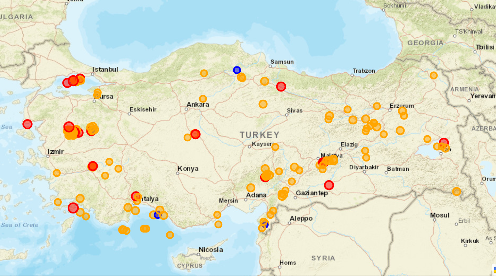
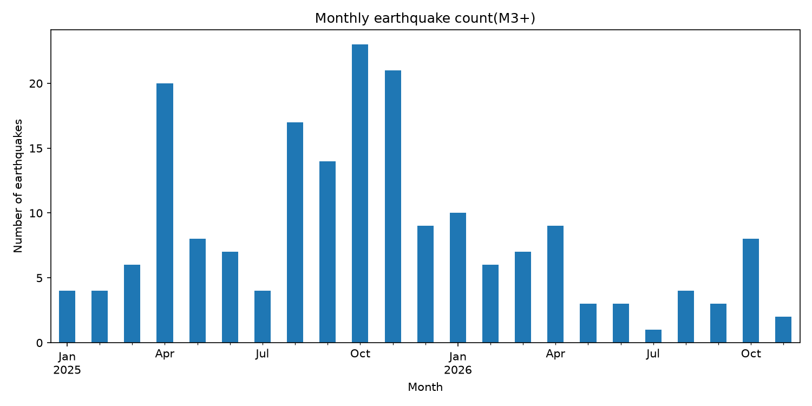
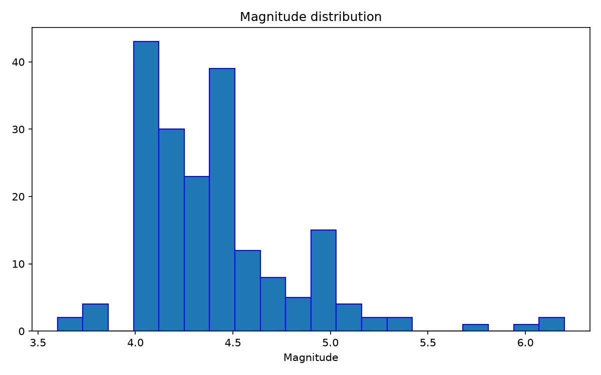

# Turkey Earthquake Analysis

This project analyses earthquake activity in Turkey using Python, pandas and USGS data and turns it into graphs using matplotlib.

> This project analyzes historical data only. It does not predict earthquakes.

## What it does

1. Fetches earthquakes (M3+) from the [USGS Earthquake API](https://earthquake.usgs.gov/fdsnws/event/1/) from 2025-01-01 up to today.
2. Converts the response into a pandas DataFrame and saves it as `data/earthquakes.csv`.
3. Keeps events whose location is labeled as Turkey.
4. Generates three static charts and an interactive map in `outputs/`.

## Results

### Interactive map


Marker size and color show magnitude (red: M5+, orange: M4-5, blue: below M4). The interactive version is `outputs/map.html`.

### Monthly earthquake count


### Magnitude distribution


## Findings

- **193 earthquakes** were kept after filtering. The strongest was **M6.2 on 2025-04-23**, followed by M6.1 (2025-08-10) and M6.0 (2025-10-27).
- **Activity peaked in April 2025 and in August to November 2025.** These peaks line up with the largest events, which are probably followed by aftershocks.
- **Most earthquakes are between M4.0 and M4.5.** Very few are below M4, likely because the catalog is less complete for small events in this region.
- **Most events are shallow (around 10 km),** with a few deeper outliers (72 km and 113 km).
- **Clusters appear in western Anatolia (around 39°N, 28°E), the Marmara region, and eastern Turkey.**

## Limitations

- The API query uses a bounding box around Turkey, so it first returns nearby regions too (e.g. Greece, Syria, Georgia). The Turkey filter uses the `place` text, so some offshore earthquakes without "Turkey" in their label are removed (193 of 584 rows were kept).
- The latest month is incomplete, so its bar is low.

## Setup

```bash
git clone https://github.com/yesilkirpi/turkey-earthquake-analysis.git
cd turkey-earthquake-analysis
python -m venv venv
venv\Scripts\activate        # macOS/Linux: source venv/bin/activate
pip install -r requirements.txt
python main.py
```

Output files are written to `data/` and `outputs/`. Open `outputs/map.html` in a browser for the interactive map.

## Project structure

```
main.py            fetching, cleaning, plotting
data/              saved CSV data
outputs/           charts and interactive map
requirements.txt   dependencies
```

## Tools

Python, requests, pandas, matplotlib, folium

## Data source

[USGS Earthquake Catalog](https://earthquake.usgs.gov/)
